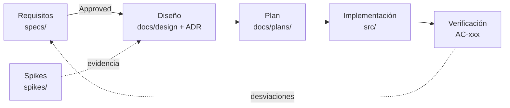

# agent-orchestrator

Herramienta para coordinar agentes y cuentas de IA y conservar la continuidad de las tareas mediante contexto y resultados revisables.

> `agent-orchestrator` y “Orquestador de agentes de IA” son nombres de trabajo; el nombre de producto sigue abierto (D-005).

**Estado:** definición de requisitos. Especificación 001 v0.3 en `Draft`. Sin arquitectura aprobada ni implementación.

## Empezar aquí

1. [CONTEXTO.md](CONTEXTO.md): estado actual, decisiones y próximos pasos (memoria del proyecto).
2. [specs/001-product-requirements.md](specs/001-product-requirements.md): requisitos de producto (fuente de verdad).
3. [docs/glosario.md](docs/glosario.md): términos del dominio.
4. [CONTRIBUTING.md](CONTRIBUTING.md): flujo de trabajo, git y convenciones.

Si trabaja con un agente de IA, las reglas están en [AGENTS.md](AGENTS.md) (Claude Code las carga mediante [CLAUDE.md](CLAUDE.md)).

## Método de trabajo: SDD

Usaremos desarrollo guiado por especificaciones (Spec-Driven Development):

1. **Requisitos** (`specs/`): problema, usuarios, alcance, reglas de negocio y criterios de aceptación.
2. **Diseño** (`docs/design/`, `docs/adr/`): arquitectura e interfaces que satisfacen los requisitos aprobados.
3. **Plan** (`docs/plans/`): unidades implementables y verificables.
4. **Implementación** (`src/`, se creará en esta etapa): desarrollo contra la especificación aprobada.
5. **Verificación**: comprobar cada criterio de aceptación y registrar resultados y desviaciones.

Una especificación en estado `Draft` expresa hipótesis y decisiones pendientes. No autoriza por sí sola a implementar. Antes de implementar una capacidad, sus requisitos y criterios de aceptación deben estar acordados. Los **spikes** (`spikes/`) reducen riesgo técnico antes del diseño y no son código de producto.



## Estructura

```
agent-orchestrator/
├── AGENTS.md            Reglas para agentes de IA (compartidas)
├── CLAUDE.md            Entrada de Claude Code (importa AGENTS.md y CONTEXTO.md)
├── CONTEXTO.md          Memoria viva: estado, decisiones, próximos pasos
├── CHANGELOG.md         Cambios notables
├── CONTRIBUTING.md      Flujo de trabajo y convenciones
├── specs/               Especificaciones SDD numeradas + plantilla
├── docs/
│   ├── glosario.md      Terminología del dominio
│   ├── adr/             Decisiones de arquitectura (ADR)
│   ├── design/          Diseño técnico
│   ├── plans/           Planes de implementación
│   ├── research/        Investigación y benchmarking
│   └── sessions/        Bitácora de sesiones de trabajo
├── spikes/              Pruebas de viabilidad desechables
└── .claude/             Configuración y skills compartidos de Claude Code
```

## Documentos

| Documento | Estado |
|---|---|
| [001 — Requisitos de producto](specs/001-product-requirements.md) | Draft v0.3 |
| [Estado del proyecto y oportunidades](docs/research/estado-y-oportunidades.md) | Informe 2026-10-04 |
| [ADR-0001 — Método SDD y registro de decisiones](docs/adr/0001-metodo-sdd-y-registro-de-decisiones.md) | Accepted |
