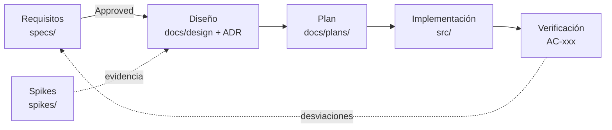

# Hilvan

**Hilvan** une agentes de IA y cuentas (Claude Code, Codex…) en un mismo flujo de trabajo: cada cuenta es una identidad aislada, el contexto pasa de un agente a otro en paquetes revisables, y tú decides qué se envía y a quién.

> El nombre viene de *hilvanar*: unir piezas con puntadas para que el trabajo continúe. Comando: `hilvan` (alias `hv`).

**Estado:** implementación del MVP (hito M0). Especificación 001 v1.0 `Approved`. Licencia [Apache-2.0](LICENSE).

## Empezar aquí

1. [CONTEXTO.md](CONTEXTO.md): estado actual, decisiones y próximos pasos (memoria del proyecto).
2. [specs/001-product-requirements.md](specs/001-product-requirements.md): requisitos de producto (fuente de verdad).
3. [docs/glosario.md](docs/glosario.md): términos del dominio.
4. [CONTRIBUTING.md](CONTRIBUTING.md): flujo de trabajo, git y convenciones.
5. [docs/design/arquitectura.md](docs/design/arquitectura.md) y [docs/plans/001-mvp.md](docs/plans/001-mvp.md): cómo se construye y en qué orden.

Si trabaja con un agente de IA, las reglas están en [AGENTS.md](AGENTS.md) (Claude Code las carga mediante [CLAUDE.md](CLAUDE.md)).

## Método de trabajo: SDD

Usaremos desarrollo guiado por especificaciones (Spec-Driven Development):

1. **Requisitos** (`specs/`): problema, usuarios, alcance, reglas de negocio y criterios de aceptación.
2. **Diseño** (`docs/design/`, `docs/adr/`): arquitectura e interfaces que satisfacen los requisitos aprobados.
3. **Plan** (`docs/plans/`): unidades implementables y verificables.
4. **Implementación** (`src/`, se creará en esta etapa): desarrollo contra la especificación aprobada.
5. **Verificación**: comprobar cada criterio de aceptación y registrar resultados y desviaciones.

Una especificación en estado `Draft` expresa hipótesis y decisiones pendientes. No autoriza por sí sola a implementar. Antes de implementar una capacidad, sus requisitos y criterios de aceptación deben estar acordados. Los **spikes** (`spikes/`) reducen riesgo técnico antes del diseño y no son código de producto.



## Estructura

```
hilvan/   (carpeta local actual: agent-orchestrator/)
├── AGENTS.md            Reglas para agentes de IA (compartidas)
├── CLAUDE.md            Entrada de Claude Code (importa AGENTS.md y CONTEXTO.md)
├── CONTEXTO.md          Memoria viva: estado, decisiones, próximos pasos
├── CHANGELOG.md         Cambios notables
├── CONTRIBUTING.md      Flujo de trabajo y convenciones
├── specs/               Especificaciones SDD numeradas + plantilla
├── docs/
│   ├── glosario.md      Terminología del dominio
│   ├── adr/             Decisiones de arquitectura (ADR)
│   ├── design/          Diseño técnico
│   ├── plans/           Planes de implementación
│   ├── research/        Investigación y benchmarking
│   └── sessions/        Bitácora de sesiones de trabajo
├── spikes/              Pruebas de viabilidad desechables
├── src/                 Código TypeScript (CLI `hilvan`)
├── tests/               Tests y fixtures
└── .claude/             Configuración y skills compartidos de Claude Code
```

## Documentos

| Documento | Estado |
|---|---|
| [001 — Requisitos de producto](specs/001-product-requirements.md) | Approved v1.0 |
| [Estado del proyecto y oportunidades](docs/research/estado-y-oportunidades.md) | Informe 2026-10-04 |
| [ADR-0001 a 0010](docs/adr/README.md) | Accepted |
| [Diseño del MVP](docs/design/README.md) | Accepted |
| [Plan 001 — MVP](docs/plans/001-mvp.md) | Accepted |
| [Investigación de foros y herramientas](docs/research/2026-10-06-foros-y-herramientas.md) | 2026-10-06 |
