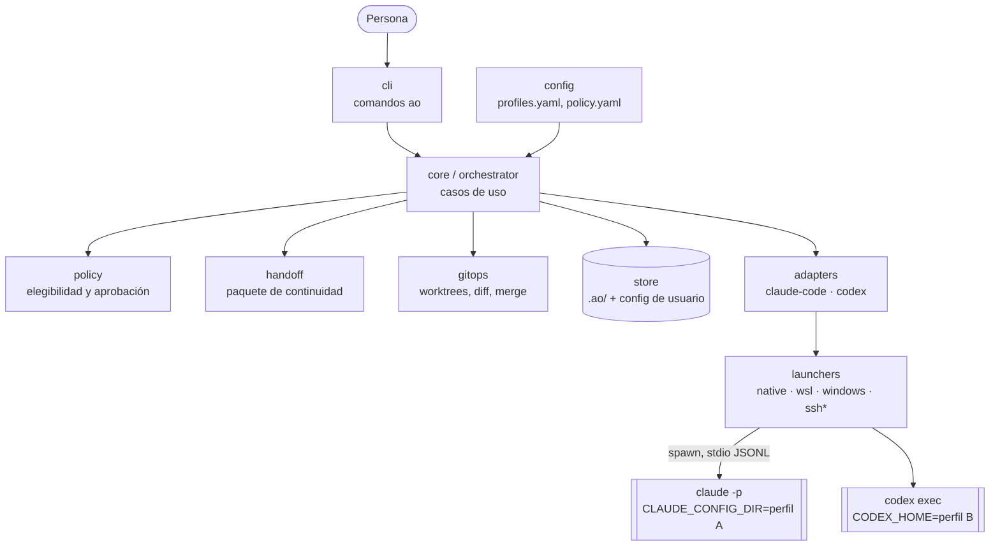
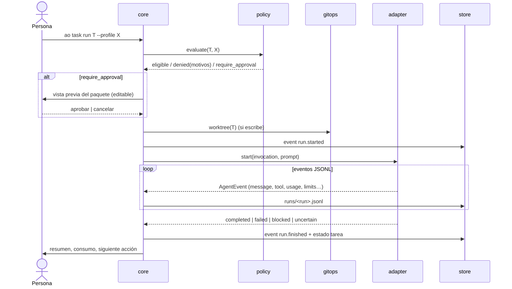

# Arquitectura

- **Estado:** Accepted (baseline del MVP)
- **Fecha:** 2026-10-06
- **Relacionado:** [spec 001 v1.0](../../specs/001-product-requirements.md), ADR-0002 a ADR-0010

## 1. Vista general

Un único proceso Node.js (`ao`) coordina perfiles que viven en distintos entornos. Lanza los CLIs oficiales de los agentes como procesos hijos y guarda todo el estado en archivos.

`*` ssh: incremento 2.

## 2. Módulos (`src/`)

| Módulo | Responsabilidad | Depende de |
|---|---|---|
| `domain/` | Tipos y esquemas zod: Profile, Destination, Project, Task, Run, HandoffPackage, Approval, Event. Máquina de estados de la tarea. Sin E/S. | — |
| `config/` | Rutas de configuración por sistema operativo; carga y validación de `profiles.yaml` y `policy.yaml` (usuario y gestionada). | domain |
| `store/` | Interfaz `Store` e implementación con archivos: escritura atómica, `events.jsonl` de solo añadido. | domain |
| `launchers/` | Funciones puras `(Destination, Command) → Invocation` (ejecutable, args, env, cwd) y traducción de rutas. | domain |
| `adapters/` | `AgentAdapter` por aplicación: construye argumentos, interpreta JSONL a `AgentEvent`, cancela, reanuda y comprueba la autenticación. | domain, launchers |
| `policy/` | Evalúa la elegibilidad (clasificación, herramientas, capacidades, reglas en capas) con motivos; ordena los perfiles elegibles. | domain, config |
| `handoff/` | Construye el paquete (hechos de git + resumen estructurado del agente de origen), detecta secretos, calcula el hash y lo renderiza en Markdown. | domain, gitops, adapters |
| `gitops/` | Worktree por tarea, hook de preparación, diff, fusión y limpieza. | — |
| `core/` | Casos de uso: crear tarea, asignar, ejecutar, bloquear o marcar como incierta, traspasar, revisar, aceptar o descartar. Orquesta y emite eventos de auditoría. | todos los anteriores |
| `cli/` | Comandos `commander` y prompts `@clack/prompts`. Solo presentación. | core |

Regla de dependencias: `domain` no importa nada del proyecto. `cli` solo habla con `core`. La futura UI web será otro cliente de `core`.

## 3. Flujos principales

### 3.1 Ejecutar una tarea

### 3.2 Traspaso a otro perfil

1. `ao handoff T --to Y`: `core` pide al perfil de origen (reanudando su sesión) un resumen con esquema JSON (`--json-schema` / `--output-schema`) y añade hechos de `gitops` (rama, commits, diff stat, archivos).
2. `handoff` detecta secretos y los marca, renderiza el Markdown, y el usuario lo edita y aprueba.
3. Se registra el hash del paquete aprobado y se crea una nueva ejecución en Y con el paquete como contexto inicial.

### 3.3 Revisión y aceptación

`ao review T` muestra el diff. `ao review T --by Z` lanza una ejecución de solo lectura en Z que adjunta su informe. `ao accept T` fusiona la rama y limpia el worktree. `ao discard T` limpia sin fusionar.

## 4. Decisiones transversales

- **Errores:** los errores de dominio son tipados (`PolicyDenied`, `ProfileUnavailable`, `AdapterProtocolError`…) y nunca provocan un cambio automático de perfil (FR-010, FR-017).
- **Concurrencia:** una ejecución activa por proyecto en el MVP, protegida con un archivo de bloqueo `.ao/lock` que incluye PID. Si el PID ya no existe al arrancar, la ejecución asociada pasa a `uncertain`.
- **Observabilidad:** `events.jsonl` (auditoría de negocio) y `runs/<id>.jsonl` (eventos crudos del agente). Ninguno contiene secretos (ver [amenazas](amenazas.md)).
- **Internacionalización:** los mensajes del CLI están en inglés en el código, con catálogo en español. La documentación de usuario está en español e inglés antes de publicar.

## 5. Evolución prevista

| Incremento | Cambio arquitectónico |
|---|---|
| 2 | `launchers/ssh`, ejecución paralela (N ejecuciones activas), UI web local (`ao ui`, servidor HTTP local + SPA) sobre `core`, notificaciones. |
| 3 | Adaptador ACP genérico, perfil de investigación (Perplexity), varios repositorios por proyecto, posible runner en Go y `Store` en SQLite. |
