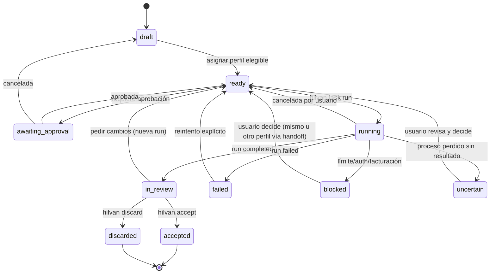

# Modelo de datos

- **Estado:** Accepted (baseline del MVP)
- **Fecha:** 2026-10-06
- **Relacionado:** ADR-0006, ADR-0007, ADR-0009; los esquemas se implementan con zod en `src/domain/`.

## 1. Configuración de usuario — `profiles.yaml`

```yaml
version: 1
profiles:
  - id: claude-corp                 # identificador estable [a-z0-9-]
    label: "Claude — corporativa"
    app: claude-code                # adaptador: claude-code | codex
    auth:
      mode: subscription            # subscription | api-key
      # apiKeyEnv: WORK_ANTHROPIC_KEY  (solo api-key: nombre de la variable, nunca el valor)
    configDir: C:\Users\me\.hilvan-profiles\claude-corp   # CLAUDE_CONFIG_DIR / CODEX_HOME, en el entorno destino
                                    # null = login por defecto del CLI: la variable se ELIMINA, no se fija
                                    # (Claude guarda la cuenta por defecto en ~/.claude.json, fuera de ~/.claude)
    destination:
      launcher: native              # native | wsl | windows | (ssh, incremento 2)
      # distro: Ubuntu-24.04        (wsl)
      executable: claude            # opcional; por defecto el de la app
    accepts: [public, corporate, confidential]   # clasificaciones que puede recibir
    tags: [corporate]               # para reglas de política
    tools:
      mcpConfig: C:\Users\me\.hilvan-profiles\claude-corp\mcp.json   # servidores MCP del perfil
      provides: [jira, confluence]  # capacidades declaradas para la elegibilidad
    model: null                     # opcional (p. ej. sonnet)
    preference: 0                   # desempate entre elegibles; mayor = preferido
```

## 2. Política — `policy.yaml` (gestionada / usuario / proyecto)

```yaml
version: 1
classifications: [public, personal, corporate, confidential]   # solo proyecto/usuario
rules:
  - id: no-corp-to-personal
    from: { classification: [corporate, confidential] }
    to: { tags: [personal] }
    effect: deny                    # deny | require_approval
    enforced: true                  # solo tiene efecto en la política gestionada
    reason: "Política de la empresa: datos corporativos no salen a cuentas personales"
```

## 3. Estado del proyecto — `.hilvan/`

```
.hilvan/
├── project.json        { id, name, baseBranch, setupHook?, createdAt }
├── policy.yaml         (opcional, solo restringe)
├── events.jsonl        auditoría append-only
├── lock                { pid, runId, startedAt } mientras hay ejecución
└── tasks/<taskId>/
    ├── task.json
    ├── brief.md
    ├── handoffs/<ho_id>.md  paquetes aprobados (inmutables, con sha256 en front matter)
    ├── reviews/<runId>.md
    └── runs/<runId>.jsonl   eventos normalizados + crudos
```

IDs: ULID con prefijo (`tsk_…`, `run_…`, `ho_…`) para que el orden por nombre coincida con el temporal.

## 4. Entidades

### Task (`task.json`)

| Campo | Tipo | Notas |
|---|---|---|
| `id` | string | `tsk_<ulid>` |
| `title` | string | |
| `classification` | string | una de las clasificaciones del proyecto |
| `mode` | `write` \| `read` | `write` crea un worktree |
| `requires` | string[] | capacidades o herramientas necesarias (p. ej. `jira`) |
| `profileId` | string \| null | asignación explícita |
| `state` | TaskState | ver §5 |
| `branch`, `worktree` | string \| null | solo si `mode=write` |
| `runs` | RunSummary[] | `{ id, profileId, state, sessionId, usage, startedAt, endedAt }` |
| `handoffs` | string[] | ids de paquetes |
| `createdAt`, `updatedAt` | ISO 8601 | |

### Run (resumen en `task.json`, detalle en `runs/<id>.jsonl`)

`state`: `running | completed | failed | blocked | cancelled | uncertain`. `blockedReason`: `rate_limit | auth | billing | permission`. `usage`: `{ costUsd?: number, inputTokens?, outputTokens?, estimated: true }`. `limits`: último `rate_limit_info` normalizado (solo Claude).

### HandoffPackage (`handoff-<n>.md` con front matter)

Front matter: `id, taskId, fromProfile, toProfile, classification, sha256, approvedAt, approvedBy, secretsFlagged`. Secciones del cuerpo, fijas y en este orden: **Objetivo, Estado, Hechos verificados, Decisiones, Supuestos (no verificados), Archivos y cambios, Resultados, Siguiente paso**.

### Event (`events.jsonl`)

`{ ts, type, taskId?, runId?, profileId?, data }`. Tipos: `task.created`, `task.assigned`, `policy.evaluated`, `approval.granted`, `approval.denied`, `handoff.approved`, `run.started`, `run.finished`, `review.attached`, `task.accepted`, `task.discarded`. Los eventos `data` nunca incluyen el contenido del paquete, solo su hash y ruta.

## 5. Máquina de estados de la tarea



Cambiar `profileId` desde `blocked`, `uncertain` o `failed` hacia otro perfil exige pasar por un handoff aprobado cuando la política lo requiera (AC-007).
