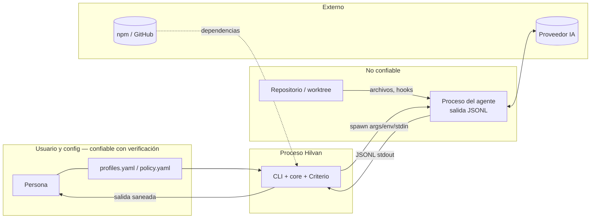

# Análisis de riesgos de seguridad — Hilvan

- **Fecha:** 2026-10-07
- **Autor:** Claude Code (rol de analista de ciberseguridad), para revisión del responsable del proyecto
- **Alcance:** CLI local `hilvan` (M0–M2 y diseño de M3–M5), cadena de suministro y CI. No cubre los CLIs de terceros (Claude Code, Codex), que se tratan como componentes externos.
- **Método:**
  - Inventario de activos.
  - Actores de amenaza.
  - Límites de confianza.
  - STRIDE por componente.
  - Matriz probabilidad × impacto.
  - Controles trazados a [requisitos de seguridad](requisitos.md) (SR-xxx).
- **Relacionado:** [modelo de amenazas del diseño](../design/amenazas.md), NFR-001, NFR-008, NFR-010, NFR-011.

## 1. Activos

| ID | Activo | Por qué importa |
|---|---|---|
| AS1 | Credenciales de los proveedores (en el directorio de configuración de cada perfil) | Permiten actuar y consumir cuota como el usuario. Hilvan no las lee, pero las ubica y las usa de forma indirecta. |
| AS2 | Datos corporativos y personales en briefs, paquetes de traspaso, salidas y diffs | Su fuga entre identidades es el riesgo central del producto. |
| AS3 | Código y repositorio del usuario (ramas, worktrees) | Integridad: un agente o un atacante podría introducir cambios maliciosos. |
| AS4 | Registro de auditoría (`.hilvan/events.jsonl`) | Prueba de quién recibió qué. Su manipulación oculta fugas. |
| AS5 | Configuración (`profiles.yaml`, `policy.yaml`, política gestionada) | Define identidades, ejecutables y restricciones. Modificarla equivale a ejecutar código o eludir la política. |
| AS6 | Modelo de Criterio (`criterio/model.json`) | Influye en las recomendaciones y los umbrales. |
| AS7 | Terminal del usuario | Puede recibir secuencias de escape de contenido no confiable. |
| AS8 | Cadena de suministro (dependencias npm, GitHub Actions, paquete publicado) | Un compromiso afecta a todos los usuarios. |

## 2. Actores de amenaza

| Actor | Capacidad | Motivación |
|---|---|---|
| A1 — Repositorio hostil (clonado de terceros) | Controla archivos, hooks, `.mcp.json`, nombres de rama y contenido que lee el agente | Ejecutar código, exfiltrar datos, inyectar prompts |
| A2 — Salida de agente comprometida o manipulada (prompt injection) | Controla el texto y los eventos JSONL que Hilvan muestra y almacena | Engañar al usuario, inyectar secuencias en la terminal, provocar traspasos |
| A3 — Proceso local de otro usuario del sistema | Lee o escribe archivos con permisos laxos y crea symlinks en rutas predecibles (`/tmp`) | Robar datos, sustituir configuración |
| A4 — Paquete npm o Action comprometidos | Ejecuta código en la instalación o en la CI | Robar secretos, troyanizar releases |
| A5 — Usuario descuidado (sin intención maliciosa) | Aprueba sin leer, mezcla cuentas, pega secretos en briefs | — (error humano) |
| A6 — Insider con privilegios de administrador local | Modifica la política gestionada | Eludir controles corporativos (riesgo aceptado en el MVP) |

## 3. Límites de confianza

## 4. STRIDE por componente

Notación: **P** probabilidad y **I** impacto, ambos de 1 a 3. **R** = P × I.

| ID | Componente | STRIDE | Escenario | P | I | R | Control / SR |
|---|---|---|---|---|---|---|---|
| T01 | CLI → terminal | Tampering / EoP | El agente o el repositorio emite secuencias ANSI/OSC: OSC 52 escribe en el portapapeles, OSC 8 crea enlaces engañosos, se reescribe la pantalla para ocultar texto y algunas terminales pueden ejecutar acciones | 2 | 3 | **6** | SR-001 |
| T02 | CLI → terminal | Spoofing | Caracteres bidi o de ancho cero en nombres de archivo o salidas hacen que un diff o una aprobación parezcan distintos (Trojan Source) | 2 | 2 | 4 | SR-001, SR-002 |
| T03 | Launchers | EoP | Inyección de argumentos u órdenes mediante el título de la tarea, rutas o el prompt | 1 | 3 | 3 | SR-003 (`spawn` sin shell, prompt por stdin) |
| T04 | Launchers (Windows) | EoP | Los shims `.cmd` y el escapado de `cmd.exe` permiten inyección (familia CVE-2024-27980) | 2 | 3 | **6** | SR-004 (cross-spawn, sin interpolación, validación de args) |
| T05 | Config | Tampering | `profiles.yaml` con permisos de escritura para otros, o sustituido por un symlink → `executable` arbitrario | 1 | 3 | 3 | SR-005, SR-006 |
| T06 | Config / store | Tampering | Symlink en `.hilvan/` o en el directorio de configuración apuntando a un archivo del usuario: Hilvan lo sobrescribe (TOCTOU) | 2 | 2 | 4 | SR-006, SR-007 |
| T07 | Parser YAML | DoS | Bomba de alias (*billion laughs*) o archivo enorme | 1 | 2 | 2 | SR-008 |
| T08 | Parser JSONL | DoS | Línea gigantesca o flujo infinito agotan la memoria | 2 | 2 | 4 | SR-009 |
| T09 | Adapters | Info disclosure | Una clave de API heredada del entorno (`ANTHROPIC_API_KEY`) hace que un perfil de suscripción actúe con otra identidad o factura | 2 | 2 | 4 | SR-010 (implementado en M1) |
| T10 | Adapters (`claude -p`) | EoP | Hooks de `.claude/settings.json` y `.mcp.json` del repositorio se ejecutan sin diálogo de confianza | 2 | 3 | **6** | SR-011 (`--strict-mcp-config`), SR-012 (aviso de hooks) |
| T11 | Handoff | Info disclosure | Secretos o datos corporativos dentro de un paquete enviado a otro perfil | 2 | 3 | **6** | SR-013, SR-014, SR-015 |
| T12 | Store / logs | Info disclosure | Secretos en `runs/*.jsonl` o `events.jsonl`; `.hilvan/` subido a git | 2 | 3 | **6** | SR-013, SR-016 |
| T13 | Auditoría | Repudiation / Tampering | Se edita o borra el registro para ocultar un envío | 1 | 2 | 2 | SR-017 (cadena de hash), SR-018 |
| T14 | Policy | EoP | La política del proyecto (que viene del repositorio, A1) relaja la del usuario o la gestionada | 2 | 3 | **6** | SR-019 (el proyecto solo restringe) |
| T15 | Policy | EoP | El usuario aprueba algo prohibido por una regla `enforced` | 1 | 3 | 3 | SR-020 |
| T16 | Criterio | Tampering | Envenenamiento del modelo (etiquetas erróneas o `model.json` manipulado) para recomendar un perfil inadecuado | 1 | 2 | 2 | SR-021 |
| T17 | Criterio | Info disclosure | El modelo guarda texto de briefs corporativos | 1 | 2 | 2 | SR-022 (feature hashing, sin texto) |
| T18 | Gitops | Tampering | Nombre de rama o ruta del repositorio con `..` o argumentos (`--upload-pack=`) inyectados en órdenes git | 1 | 3 | 3 | SR-003, SR-023 |
| T19 | Gitops | Tampering | Fusionar sin revisar un diff malicioso del agente | 2 | 3 | **6** | SR-024 (aceptar exige diff mostrado + riesgo de Criterio) |
| T20 | Proceso | DoS | Agente colgado o en bucle consume cuota | 2 | 2 | 4 | SR-025 (timeouts, cancelación, estado `blocked`) |
| T21 | Supply chain | EoP | Dependencia npm comprometida o script `postinstall` malicioso | 2 | 3 | **6** | SR-026, SR-027 |
| T22 | CI | EoP | Action de terceros referenciada por tag mutable, o token con permisos amplios | 1 | 3 | 3 | SR-028 |
| T23 | Distribución | Spoofing | Paquete homónimo o typosquatting (`hilvan`) | 1 | 3 | 3 | SR-029 (publicación con provenance; reservar nombre) |
| T24 | Usuario | Info disclosure | El usuario pega un secreto en el brief | 2 | 2 | 4 | SR-013 (detector al crear la tarea) |
| T25 | Config | Info disclosure | Directorios de perfil con permisos laxos o bajo `/tmp` | 1 | 3 | 3 | SR-030 (implementado en M1, ampliado) |

**Riesgos prioritarios (R ≥ 6):** T01, T04, T10, T11, T12, T14, T19 y T21. Todos tienen control implementado o planificado en el hito en que aparece el componente.

## 5. Riesgos residuales aceptados

- **A6 (administrador local):** la política gestionada no protege frente a quien administra el equipo.
- **Hooks del repositorio con `claude -p`:** solo se avisa, porque desactivarlos exige `--bare`, que no admite el login de suscripción. Se reevaluará si Claude Code ofrece una opción de confianza por proyecto en modo `-p`.
- **Codex no permite verificar la cuenta concreta.**
- **Salida del agente semánticamente maliciosa** (instrucciones engañosas en texto plano): Hilvan la sanea a nivel de terminal, pero no puede juzgar su intención. La revisión humana y la revisión cruzada siguen siendo el control.

## 6. Revisión

Revisar este análisis en cada hito que añada un componente (M3 política, M4 handoff, incremento 2 con UI web y SSH) y antes de cada release.
